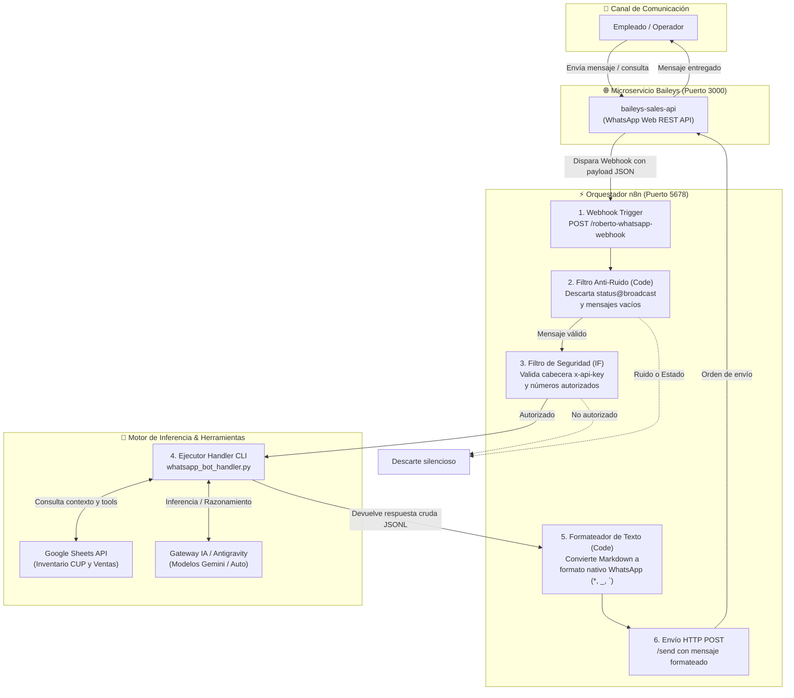

# ROBERTO — Agente de Operaciones por WhatsApp

Asistente virtual de operaciones para atención y consultas por WhatsApp conectado a modelos LLM, hojas de inventario/ventas en Google Sheets y microservicios de mensajería con filtrado de seguridad Zero-Trust.

---

## 🏛️ Arquitectura del Sistema

El siguiente diagrama detalla el ciclo de vida del mensaje, las capas de filtrado de ruido y seguridad, y la interacción con los motores de datos e inferencia:



---

## 📂 Estructura de Archivos

- `workflow_Q5iI4KQ5PzWL3Bax_roberto_whatsapp.json`: Flujo de producción para la interacción bidireccional por WhatsApp.
- `workflow_ypgDcdzMJNfiF92L_roberto.json`: Flujo alternativo para bot de Telegram con filtrado Zero-Trust.
- `workflow_Da1VzjJddyBGAcWr_asistente_yourbrand_-_telegram_bot_sheets_lineal.json`: Integración con Google Sheets para consulta de stock y facturación.
- `docker-compose.yml`: Plantilla de despliegue portable para levantar una instancia de n8n con los flujos.
- `.env.example`: Variables de entorno y configuración necesarias para el entorno.
- `requisitos.md`: Documento de requisitos formales (PRD) y reglas de negocio.
- `roberto-whatsapp.spec.md`: Especificación técnica y certificación de criterios de aceptación.

---

## ⚙️ Variables de Entorno (`.env.example`)

| Variable | Propósito | Ejemplo / Default |
| :--- | :--- | :--- |
| `PORT_N8N` | Puerto expuesto para la interfaz web de n8n | `5678` |
| `N8N_ENCRYPTION_KEY` | Clave secreta para cifrar credenciales en base de datos | `yourbrand_encryption_key_v1!` |
| `BAILEYS_API_KEY` | Clave de autenticación para la API REST de WhatsApp (`x-api-key`) | Clave privada generada |
| `TELEGRAM_BOT_TOKEN` | Token del bot de Telegram (en caso de usar canal Telegram) | Token de BotFather |
| `POSTGRES_USER` | Usuario de base de datos para PostgreSQL de n8n | `n8n_user` |
| `POSTGRES_PASSWORD` | Contraseña de base de datos | Contraseña segura |
| `POSTGRES_DB` | Nombre de base de datos de n8n | `n8n_roberto` |

---

## 🚀 Despliegue Portable (Docker)

1. **Configurar el entorno:**
   ```bash
   cp .env.example .env
   ```
   Rellenar los valores en `.env` con las claves reales de tu entorno.

2. **Levantar el servicio:**
   ```bash
   docker compose up -d
   ```

3. **Importar flujos en n8n:**
   ```bash
   docker exec -it roberto-n8n n8n import:workflow --input=/workflows/workflow_Q5iI4KQ5PzWL3Bax_roberto_whatsapp.json
   ```
